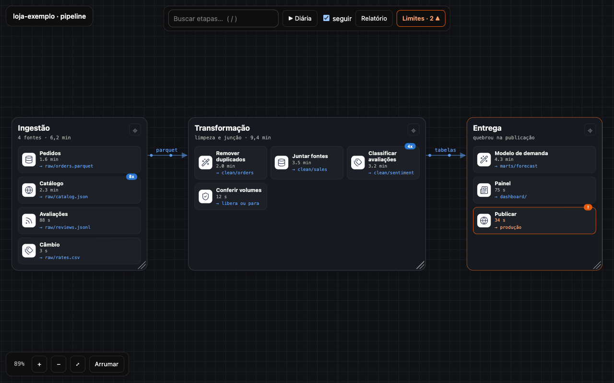

# pipeline-board

**See, understand and speed up your pipeline.** A plugin for **Claude Code** that turns your project into an interactive board and publishes it to **your own artifact**.


[MP4 video](docs/demo.mp4) · The pipeline in the demo is **made up**. The board labels and video captions are in Portuguese.

## Works with Claude Code

Installing from this repository was checked with **Claude Code 2.1.332** on macOS: the marketplace was added, the plugin installed and the 4 skills present at that time were listed (`gaps` was added later). The `map` skill was then run once in a fresh headless session: it was triggered by a plain request and produced a valid spec, but the scripts were blocked by the test's own permission rules, so the guided flow has not yet run end to end.

## Install

Inside Claude Code:

```
/plugin marketplace add lucianfialho/pipeline-board
/plugin install pipeline-board@pipeline-board
```

To try a local copy for one session: `claude --plugin-dir <folder>`.

Requirements: Python 3.9+ and, to read your runs, an authenticated [`gh`](https://cli.github.com/) CLI. Publishing to an artifact needs a Claude account where artifacts are available. The scripts also work without it and produce a local HTML file.

## Use

Open Claude Code in your repository and ask:

> draw my pipeline

The skill instructions are written in Portuguese. They tell Claude to answer in your language.

| Skill | Ask when | What it does |
|---|---|---|
| `/pipeline-board:map` | "draw my pipeline" | Reads GitHub Actions runs or your code, groups steps into cards, scans for secrets and publishes to your artifact |
| `/pipeline-board:gaps` | "find the gaps in my pipeline" | Looks for truncated or stale data, failures that look like success and lost work, and shows each as **confirmed** or **suspected** |
| `/pipeline-board:explain` | "what does this step do?" | Reads your code and fills in the flow, measurements, **real examples**, latest records and models used |
| `/pipeline-board:speedup` | "this is slow" or "this broke" | Finds the actual bottleneck, parallelizes in code and **measures before and after** |
| `/pipeline-board:fix` | paste the context copied from a finding | Checks whether the claim is real, reproduces it with a failing test, **asks before changing code**, then fixes it on a separate branch |
| `/pipeline-board:watch` | "keep my board up to date" | Turns the update hooks on or off for a project |
| `/pipeline-board:limits` | "how close are we to a limit?" | CI minutes, job timeout, cache and files per deploy |

## Any project

The board only needs cards, steps and connections, described in `spec.json`. There are three ways to fill it in, and they can be combined:

| Source | Works with | You get |
|---|---|---|
| `collect.py` | GitHub Actions | Steps, durations and failures, collected automatically |
| Claude reading your code | Cron, Makefiles, scripts, orchestrators, apps, bots, agents | Structure and flow, marked as read from code, with no durations |
| `trace.py` | Anything that runs as a command, in any language or CI | Measured durations, exit codes and replay |

```bash
export PIPELINE_RUN=$(date +%Y-%m-%dT%H:%M:%S)   # steps sharing this value are one run
python3 trace.py run "download data" --group "Ingest" -- python3 download.py
python3 trace.py spec trace.jsonl -o spec.json                      # board from the recording
python3 trace.py spec trace.jsonl -o spec.json --merge spec.json    # add timings to a board you already have
```

`trace.py` is a single file using only the standard library. It passes output and exit code through, and it does not record command arguments or output. Step and group names are recorded. It measures commands: phases inside one process need to be split into separate commands. Replay plays steps one at a time, so for steps that ran in parallel its clock shows the sum of their durations, not the elapsed time.

A board built only from reading code can be wrong, especially for calls decided at runtime.

## Keeping the board up to date

Ask **"keep my board up to date"**. The `watch` skill turns on two hooks for that project:

- **When a session starts,** new GitHub Actions runs are merged into your board. Only durations, results and replays change. Cards, flows, examples, findings and limits are preserved. Steps are matched by their `ci` field (`"Workflow :: Step name"`) or by an identical, unambiguous name.
- **After Claude runs `git push` or `gh workflow run`,** Claude is told the board will be stale until the run finishes.

Rules:

- Hooks do nothing in projects you have not turned on. The activation is stored in the plugin data folder, not in the repository, so a cloned project cannot turn itself on.
- By default Claude **asks before publishing**. Automatic publishing is a separate opt-in. It pauses if the secret scan finds something or if findings changed since the last publication, and Claude is told not to publish if the artifact is no longer private. That last check is an instruction to Claude, not something the script can enforce.
- Hooks only run while Claude Code is open. Runs that finish while it is closed show up in the next session.
- The spec file in your project is rewritten when new runs arrive. GitHub Actions only. Needs `gh` and `python3`.

## What the board does



- **Infinite canvas.** Drag to pan, pinch or ⌘/Ctrl + scroll to zoom, move cards and resize them: steps reflow and arrows redraw. One button restores the auto layout.
- **Inside each step.** Flow with loops, parallelism and decisions; measurements; a real example; latest records; where it writes.
- **Full audit (optional).** Ask for an audit with agents: three read-only agents search in parallel (data, silent failures, operations) and a fourth tries to refute their claims. It costs more than the default mode.
- **Registry.** A searchable list of what the pipeline reads (`catalog`), with type filters and a form that opens a prefilled GitHub issue to add an entry. Custom icons are supported.
- **Findings.** Problems appear on the step and in one panel, split into confirmed and suspected. The builder rejects a confirmed finding with no evidence.
- **Replay.** A run plays back in seconds, with a clock, and stops where it broke.
- **Search** (`/` or ⌘K) across names, files, flows and examples.
- **Copy context.** One click copies a step as text, ready to paste into Claude and ask for a fix.
- **Ask.** Inside an artifact, a question builds an answer out of blocks. The model picks the blocks and may write short sentences, labeled as model-written. Charts and lists come from the board data.
- **Limits** with a warning from 80%. Missing data shows as not measured, never as zero.


## Without Claude

```bash
python3 scripts/collect.py owner/repo -o spec.json     # first draft from your runs
python3 scripts/limits.py owner/repo --spec spec.json  # limits
python3 scripts/check.py spec.json                     # look for secrets before publishing
python3 scripts/build.py spec.json -o board.html       # a single HTML file, opens in a browser
```

The spec format is described in [references/spec.md](references/spec.md) (in Portuguese), with an example in [examples/demo.spec.json](examples/demo.spec.json).

## Before you share

- The board shows workflow names, file names, failures and records. **Artifacts start private; read the board before sharing it.** `check.py` looks for keys, tokens, vault references, e-mail addresses and home folder paths. It is not an audit: names of people and customers get through.
- Text coming from logs is inserted as text, never as HTML.
- Natural language questions use the Claude account of whoever asks, and model-written text can be wrong.

## Limitations in this version

- Automatic collection from a provider covers **GitHub Actions only**, using the latest run of each workflow. There are no importers for GitLab, Airflow or others: use `trace.py`, or let Claude write the spec from the code.
- `limits.py` reads GitHub Actions only. Other limits are added to the spec by hand.
- Mapping apps, bots and agents has not been tested yet.
- The automatic draft has steps, durations and results. **Flows and real examples come from the `explain` skill**, which reads your code.
- The board is a snapshot. It does not update live.
- Tested in desktop Chrome. Phones and other browsers have not been tested.

## Development

```bash
python3 -m unittest discover -s tests
claude plugin validate .
python3 scripts/build.py examples/demo.spec.json -o docs/demo.html
node scripts/record.mjs docs/demo.html docs   # re-records the video; needs Chrome and ffmpeg
```

`record.mjs` drives the board with real mouse and keyboard events and **fails if an interaction stops working**.

## Credits

Design ideas learned from [diagram-design](https://github.com/cathrynlavery/diagram-design) (density limits, look before delivering), [stack-diagram](https://github.com/caru-ini/stack-diagram) (grid, light tiles, right-angle arrows) and [lanshu-animated-architecture-diagram](https://github.com/cclank/lanshu-animated-architecture-diagram) (animated flow). The code in this plugin is original. Icons: [Lucide](https://lucide.dev), ISC license.
