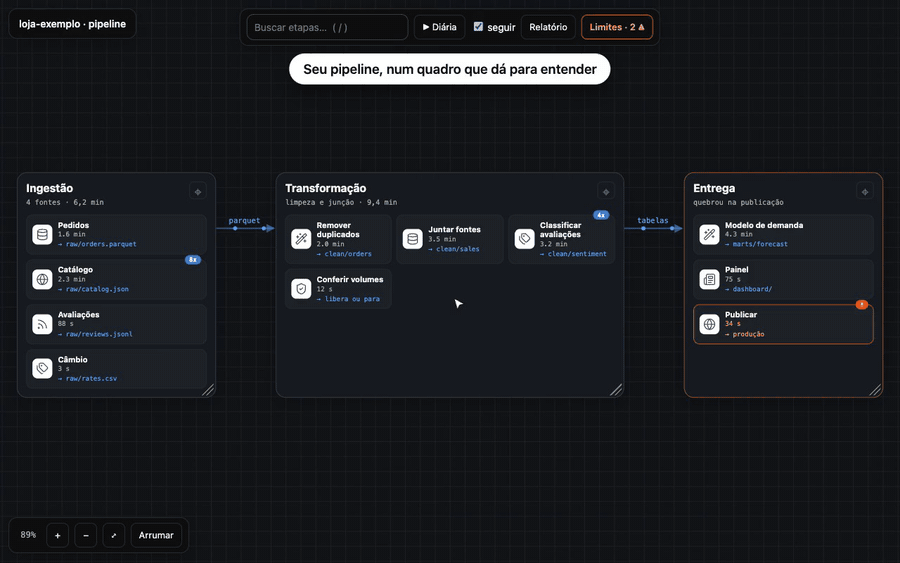
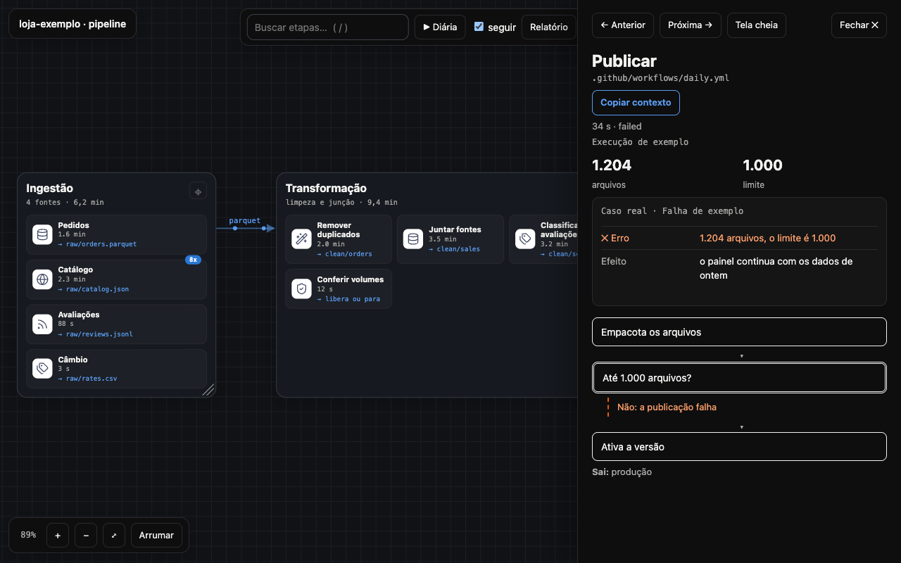
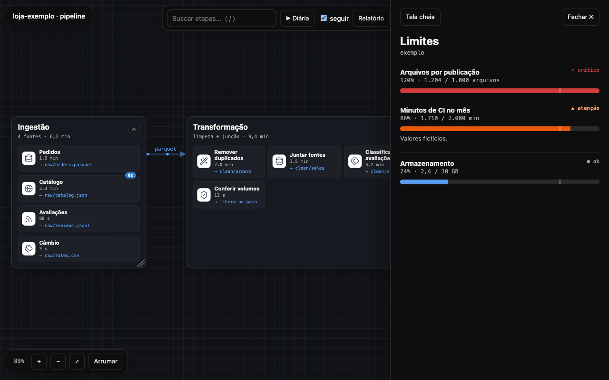

# pipeline-board

**Veja, entenda e acelere o seu pipeline.** Um plugin do Claude Code que transforma as execuções reais num quadro interativo e publica no **seu artefato**, sem você precisar montar nada.



[Vídeo em MP4](docs/demo.mp4) · o pipeline do vídeo é **fictício**.

## Instalar

```
/plugin marketplace add molholabs/pipeline-board
/plugin install pipeline-board@pipeline-board
```

O repositório é privado: quem instala precisa de acesso a ele no GitHub. Para experimentar numa sessão a partir de uma cópia local: `claude --plugin-dir <pasta>`.

Precisa de Python 3.9+ e, para ler as execuções, da CLI [`gh`](https://cli.github.com/) autenticada.

## Usar

Abra o Claude Code no seu repositório e peça:

> desenha o meu pipeline

| Skill | Quando usar | O que faz |
|---|---|---|
| `/pipeline-board:map` | "desenha o meu pipeline" | Lê as execuções do GitHub Actions, organiza em cartões, confere e publica no artefato |
| `/pipeline-board:explain` | "o que essa etapa faz?" | Lê o código e preenche fluxo, medidas, **casos reais**, últimos registros e modelos usados |
| `/pipeline-board:speedup` | "isso está lento" ou "quebrou" | Acha o limite verdadeiro, paraleliza no código e **mede antes e depois** |
| `/pipeline-board:limits` | "quanto falta para estourar?" | Minutos de CI, tempo máximo do job, cache e arquivos por publicação |

## O que o quadro faz


- **Canvas sem fim.** Arraste, aproxime com pinça ou ⌘/Ctrl + rolagem, mova os cartões e mude a largura: as etapas se reorganizam e as setas se redesenham. **Arrumar** volta ao layout automático.
- **Cada etapa por dentro.** Fluxo com repetições, paralelismo e decisões; medidas; caso real; últimos registros; arquivo onde grava.
- **Replay.** Uma execução real passa em segundos, com relógio, e para onde quebrou.
- **Busca** (`/` ou ⌘K) em nomes, arquivos, fluxos e casos.
- **Copiar contexto.** Um clique copia a etapa em texto para colar no Claude e pedir a correção.
- **Perguntar.** Dentro de um artefato, uma pergunta monta a resposta com blocos. O modelo escolhe os blocos e pode escrever frases curtas, marcadas como do modelo; gráficos e listas saem dos dados do quadro.
- **Limites** com aviso a partir de 80%. Sem dado aparece "não medido", nunca zero.





## Sem o Claude

```bash
python3 scripts/collect.py dono/repo -o spec.json     # rascunho a partir das execuções
python3 scripts/limits.py dono/repo --spec spec.json  # limites
python3 scripts/check.py spec.json                    # procura segredos antes de publicar
python3 scripts/build.py spec.json -o board.html      # um HTML só, abre em qualquer navegador
```

O formato da descrição está em [references/spec.md](references/spec.md), com um exemplo em [examples/demo.spec.json](examples/demo.spec.json).

## Cuidados

- O quadro mostra nomes de rotinas, arquivos, falhas e registros. **O artefato nasce privado; leia antes de compartilhar.** `check.py` procura chaves, tokens, e-mails e pastas pessoais, e não é uma auditoria: nomes de pessoas e de clientes passam.
- Texto vindo de logs entra na página como texto, nunca como HTML.
- A pergunta em linguagem natural usa a conta do Claude de quem pergunta, e o texto do modelo pode estar errado.

## Limites desta versão

- A coleta automática é só de **GitHub Actions**, e usa a execução mais recente de cada rotina. Outros orquestradores exigem escrever a descrição.
- O rascunho automático traz etapas, tempos e resultado. **Fluxo e casos reais vêm da skill `explain`**, lendo o seu código.
- Não há cadastro de fontes nem atualização ao vivo: o quadro é um retrato.
- Testado em Chrome no computador. Celular e outros navegadores não foram testados.

## Desenvolvimento

```bash
python3 -m unittest discover -s tests
claude plugin validate .
python3 scripts/build.py examples/demo.spec.json -o docs/demo.html
node scripts/record.mjs docs/demo.html docs   # regrava o vídeo; precisa de Chrome e ffmpeg
```

`record.mjs` usa mouse e teclado de verdade e **falha se uma interação não funcionar**.

## Créditos

Ideias de desenho aprendidas com [diagram-design](https://github.com/cathrynlavery/diagram-design) (limite de densidade, olhar antes de entregar), [stack-diagram](https://github.com/caru-ini/stack-diagram) (grade, blocos claros, setas em ângulo reto) e [lanshu-animated-architecture-diagram](https://github.com/cclank/lanshu-animated-architecture-diagram) (fluxo animado). O código deste plugin é próprio. Ícones: [Lucide](https://lucide.dev), licença ISC.
